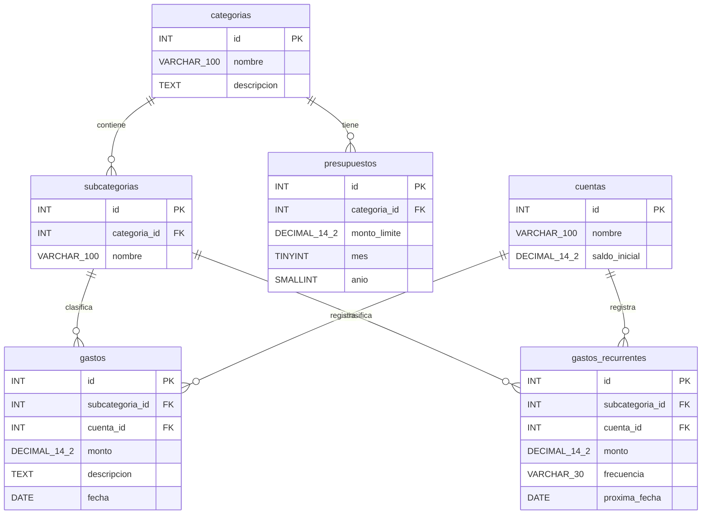

# Estructura de la base de datos

**Proyecto:** Mis gastos  
**Estudiantes:** Nestor Alejandro Mamani Condori y Ariel Alvarez Mamani

La base de datos `dbgastos` organiza las categorías, cuentas, gastos y presupuestos de la aplicación. El siguiente diagrama representa las tablas del dominio definidas en `sql/dbgastos.sql`.

`PK` identifica una clave primaria y `FK` una clave foránea. Cada relación del diagrama indica que un registro de la tabla principal puede estar asociado con cero o varios registros de la tabla relacionada; cada registro relacionado pertenece a un único registro principal.

## Función de las tablas

- **categorias:** agrupa los gastos por categorías generales.
- **subcategorias:** clasifica los gastos dentro de una categoría.
- **cuentas:** registra las cuentas y su saldo inicial.
- **gastos:** almacena el monto, la fecha y la descripción opcional de cada gasto, junto con su cuenta y subcategoría.
- **presupuestos:** define un límite de gasto para una categoría, mes y año.
- **gastos_recurrentes:** guarda gastos periódicos, su frecuencia y su próxima fecha.

## Reglas principales

- Los identificadores son enteros sin signo y se generan automáticamente. Los campos `mes` y `anio` también son enteros sin signo.
- Los montos de gastos, gastos recurrentes y presupuestos deben ser mayores que cero. El saldo inicial de una cuenta es cero por defecto.
- El mes del presupuesto debe estar entre 1 y 12 y el año entre 1 y 9999. Solo puede existir un presupuesto por categoría, mes y año.
- Las descripciones de categorías y gastos son opcionales; los demás campos son obligatorios.

Flask-AppBuilder también administra tablas de seguridad para usuarios, roles y permisos; estas no forman parte del esquema de dominio mostrado en el diagrama.
